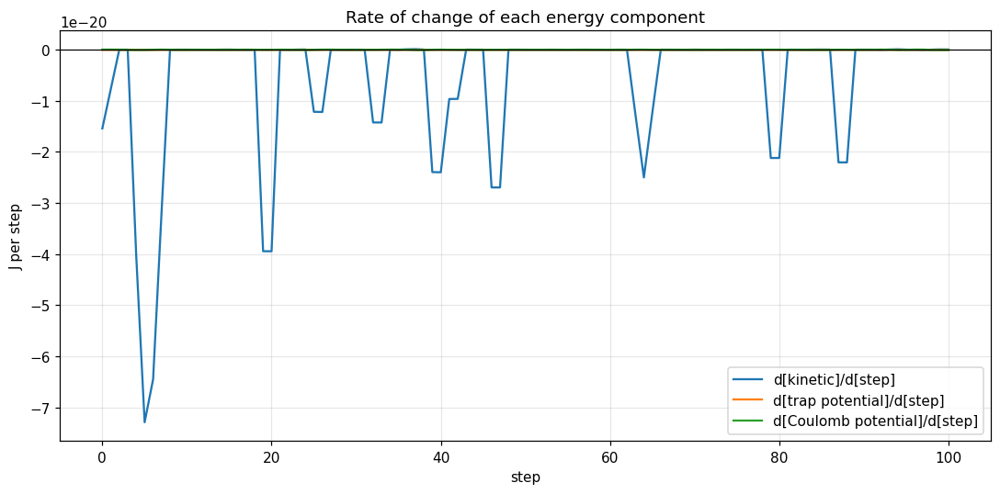
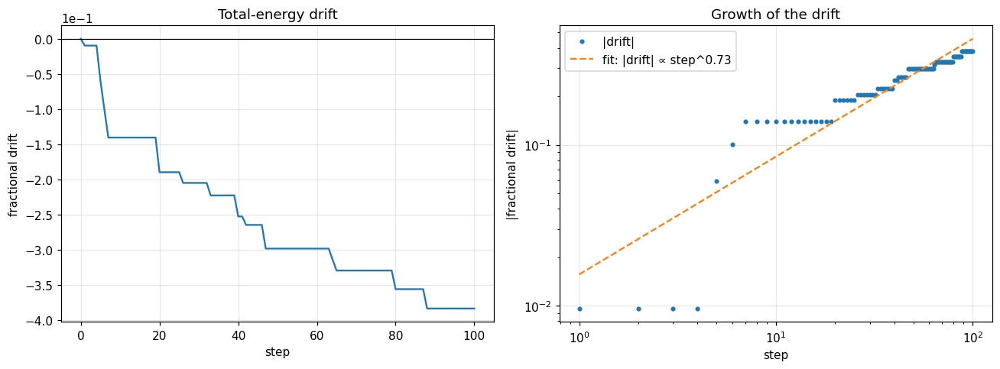
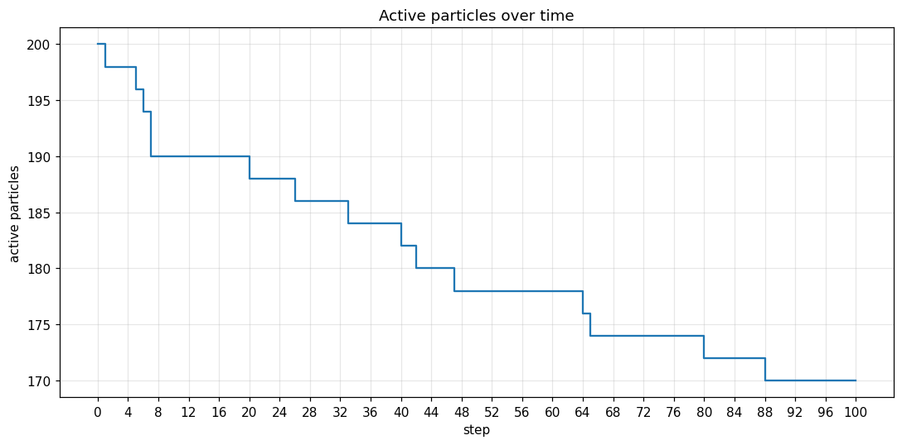

# Antimatter-kernel

This repository provides an **agent-based simulation** of charged antimatter plasmas confined in a **Penning trap**, built on the [BioDynaMo](https://biodynamo.org) framework. Charged particles and anti-particles are BioDynaMo agents that move under the trap's electromagnetic fields, their mutual Coulomb interaction, optional cyclotron radiation cooling and stochastic annihilation on proximity to opposite species.

The project is part of an effort to extend BioDynaMo with a plugin module for charged-particle simulation by integrating compuational modeling and particle physics, motivated by the [prior report](https://repository.cern/records/7capf-rqp49) based on Penning-trap simulations for the CERN AEgIS experiment.

> **Status:** Early development. All quantities are in SI units unless stated otherwise.

---

## Table of Contents
1. [Building the simulation](#building-the-simulation)
2. [Running the simulation](#running-the-simulation)
3. [Project Overview](#project-overview)
4. [Project Example](#project-example)
5. [Project Structure](#project-structure)
6. [Physics Model](#physics-model)
7. [Dependencies](#dependencies)
8. [Input Parameters](#input-parameters)
9. [Visualizing Results](#visualizing-results)

---
## Building the simulation

Option 1:
```bash
biodynamo build
```

Option 2:
```bash
mkdir build && cd build
cmake ..
make -j <number_of_processes_for_build>
```

## Running the simulation

Before running the simulation, you need to build it. If you haven't done so, 
please go back to step 1.

Option 1:
```bash
biodynamo run
```

Option 2:
```
./build/antimatter-kernel
```
---
---

## Project Overview

A **Penning trap** confines charged particles using a strong axial magnetic field together with a static electric quadrupole field. Traps of this kind are used to hold and manipulate antimatter, for example positrons and antiprotons for antihydrogen formation. Simulating the plasma in the trap requires following many interacting charged particles over a very large number of time steps, which makes it a natural fit for a high-performance agent-based framework.

The **antimatter-kernel** models each particle as a BioDynaMo agent and lets users:

1. Set up a trap from its geometry (`b0`, `trap_voltage`, `z0`, `rho0`).
2. Load several species at once, each species with its own population and temperature.
3. Choose between a direct, a Barnes-Hut and a fast multipole Coulomb solver.
4. Switch cyclotron cooling and annihilation on or off.
5. Track kinetic, trap and Coulomb potential energy over time and export the results to CSV and ParaView.
---

## Example Simulation

### Parameter Configuration

The is a minimal example case run: 100 electrons, 100 positrons, intial_temperature set as 1000K, both Coulomb interaction and annihilation enabled.

```json
{
  "seed": 42,
  "b0": 1,
  "trap_voltage": 10,
  "z0": 0.01,
  "rho0": 0.01,

  "num_steps": 1e2,

  "particle_populations": { "positron": 100, "electron": 100},
  "particle_temperatures": { "positron": 1e3, "electron": 1e3},
  "initial_cloud_radii": { "radius_x": 1e-4, "radius_y": 1e-4, "radius_z": 1e-4},

  "bath_temperature": 4,
  "cooling_scale": 1,

  "coulomb_forces_enabled": true,
  "coulomb_computation_method": "standard",
  "energy_computation_method": "standard",
  "cutoff_radius": 1e-5,
  "barnes_hut_theta": 0.7,
  "fast_multipole_order": 4,
  "fast_multipole_theta": 0.5,

  "annihilation_enabled": true,
  "contact_radius": 5e-6,
  "annihilation_probability": 1
}
```

### Rate of exchange in energy
 

### Fractional drift in energy throughout simulation


### Annihilation events
 

### Simulation in Paraview

https://github.com/user-attachments/assets/0dcd32d6-9636-44db-9552-d191ea95362c

---

## Project Structure

The project is organized into the following components:

### Core Simulation Files (`src/`)

- **antimatter-kernel.h` / `antimatter-kernel.cc**: Declare and define the `Simulate` function and `main`. `Simulate` registers the parameter groups, builds the `PenningTrapField`, creates the particles with their behaviours, runs the main loop (Coulomb forces, then one scheduler step), and writes the energy log.

- **agents/charged_antiparticle.h / .cc**: Defines the `ChargedAntiparticle` agent, which carries position, velocity, charge, mass, species, an annihilated flag and the Coulomb force computed for the current step.

- **agents/particle_species.h**: Defines the particle species (positron, electron, antiproton, proton) and their properties.

- **fields/penning_trap.h / .cc**: Defines the `PenningTrapField`. It is built from the trap geometry with `MakeFromGeometry`, provides the electric and magnetic field at a position, and generates the initial particle positions in a configurable *ellipsoidal cloud* and Gaussian thermal velocities.

- **forces/lorentz.h / .cc**: The `LorentzForce` behaviour. It advances each particle with the Boris pusher, combining the trap electric field and the Coulomb force, and then resets the stored Coulomb force.

- **forces/cooling.h / .cc**: The `CyclotronCooling` behaviour. It damps the velocity component perpendicular to **B** using the Larmor radiation rate, with an optional Langevin thermal floor set by `bath_temperature`.

- **interaction/coulomb_interaction.h / .cc**: `ComputeStandardCoulombForces`, the direct solver. It uses BioDynaMo's neighbour search with a cutoff radius and OpenMP.

- **interaction/barnes-hut.h / .cc**: `ComputeBarnesHutCoulombForces`, an octree solver with a monopole approximation and an opening angle `theta`. `theta = 0` reproduces the exact all-pairs result.

- **interaction/fast-multipole.h / .cc**: `ComputeFastMultipoleCoulombForces`, the fast multipole solver with configurable `order` and `theta`.

- **interaction/annihilation.h / .cc**: The `AnnihilationInteraction` behaviour. Particle/antiparticle pairs within `contact_radius` annihilate with probability `annihilation_probability`.

- **analysis/energy_analysis.h / .cc**: `ComputeTotalEnergy` and `EnergyBreakdown`: kinetic energy, trap potential energy and Coulomb potential energy.

- **params/physics_params.h / .cc**, **interaction_params.h / .cc**, **stochastic_params.h / .cc**: The parameter groups (`PhysicsParams`, `InteractionParams`, `StochasticParams`). Each provides `LoadParams` to read `params.json`, `Validate` to check the values and `PrintParams` to display them.

- **utils/constants.h**: Physical constants (for example the Coulomb constant).

### Configuration Files

- **params.json**: JSON parameter file for configuring runs without recompilation.
- **bdm.toml**: BioDynaMo runtime configuration (neighbour-search environment, scheduled operations, ParaView export).
- **CMakeLists.txt**: CMake build configuration that integrates with BioDynaMo.

### Tests

- **`test/`**: Unit tests (GoogleTest).

---

## Physics Model

### Equation of motion

Each particle of charge `q` and mass `m` is advanced with the Boris algorithm:

```
F_total = q E_trap(x) + F_coulomb
v-      = v + (F_total / m) (dt / 2)
t       = (q B / m) (dt / 2)
v'      = v- + v- x t
s       = 2 t / (1 + |t|^2)
v+      = v- + v' x s
v_new   = v+ + (F_total / m) (dt / 2)
x_new   = x + v_new dt
```

The Boris scheme preserves the magnitude of the velocity under a pure magnetic rotation, which is why it is the standard choice for magnetised plasmas. The time step `dt` must resolve the cyclotron period `2 pi m / (|q| B)`.

### Coulomb interaction

\[\text{fractional\_drift} = \frac{E_{\text{total}}(t) - E_{\text{total}}(0)}{\vert{}E_{\text{total}}(0)\vert{}}\]

| Method | Key | Notes |
| --- | --- | --- |
| Direct | `standard` | Neighbour search with a finite `cutoff_radius`. A cutoff that is small compared to the cloud truncates a long-range force, so it is to be treated as an approximation. |
| Barnes-Hut | `barnes_hut` | Octree with monopole terms; the accuracy set by `barnes_hut_theta` from *params.json*. |
| Fast multipole | `fast_multipole` | The accuracy here is set by `fast_multipole_order` and `fast_multipole_theta` from *params.json*. |

### Cyclotron cooling

A gyrating charge always radiates according to the Larmor formula. The perpendicular energy decays exponentially with e-folding time

```
tau_E = 3 pi eps0 m^3 c^3 / (q^4 B^2)
```

and the perpendicular velocity decays at half that rate:

```
v_perp(t + dt) = v_perp(t) * exp(-dt / (2 tau_E))
```

The parallel velocity (along **B**) is left untouched, and the exact exponential keeps the update stable even when `tau_E` is shortened artificially.

- **Thermal floor:** with `bath_temperature > 0`, Gaussian noise of variance `kB T / m * (1 - decay^2)` is added to the two perpendicular components each step, so the perpendicular motion relaxes to the bath temperature.
- **Time scaling:** the cooling time actually used is `tau_used = cooling_scale * tau_E`. Real cooling times are far longer than a simulated run, so values well below 1 are needed to see cooling. 

Both of the above parameters are taken from `params.json`.
**Note: ** - A reduced `cooling_scale` changes the balance between cooling and competing processes such as Coulomb heating. Although the equilibrium temperature is unaffected, but dynamics that depend on that balance differ from the real system. Setting the `cooling_scale` to 1 to simulates real system results.

### Annihilation

Particles of opposite matter type that come within `contact_radius` annihilate with probability `annihilation_probability` per check. Annihilated particles are skipped by the force, cooling and energy routines and are removed from subsequent simulation evaluations.

## Dependencies

- [BioDynaMo](https://biodynamo.org/)
- CMake (the version required by your BioDynaMo installation)
- GCC or Clang with C++17 support
- OpenMP
- GoogleTest (for unit testing)
- ParaView (optional, for visualization)

**Note:** Ensure BioDynaMo is installed and sourced before building or running the simulation. When it is sourced, `[bdm-<version>]` appears in your prompt:

```
. <path_to_biodynamo>/build/bin/thisbdm.sh
```

---

## Input Parameters

All parameters are set in `params.json` and can be changed without recompiling the model. The tables below list the values from the `params.json` shipped with the repository.

### Trap and Run Parameters

| Parameter | Value | Units | Description |
| --- | --- | --- | --- |
| `seed` | 42 | - | Seed for random number generation (reproducibility) |
| `b0` | 1 | T | Axial magnetic field strength |
| `trap_voltage` | 10.0 | V | Trap electrode potential |
| `z0` | 0.01 | m | Trap half-length (geometry) |
| `rho0` | 0.01 | m | Trap radial dimension (geometry) |
| `num_steps` | 1e2 | steps | Number of simulation steps |


### Particle Parameters

| Parameter | Value | Units | Description |
| --- | --- | --- | --- |
| `particle_populations` | `{positron: 100, electron: 100}` | - | Number of particles per species |
| `particle_temperatures` | `{positron: 1000, electron: 1000}` | K | Initial temperature per species (sets the Gaussian velocity spread) |
| `initial_cloud_radii` | `{radius_x: 1e-4, radius_y: 1e-4, radius_z: 1e-4}` | m | Radii of the initial ellipsoidal cloud |

### Cooling Parameters

| Parameter | Value | Units | Description |
| --- | --- | --- | --- |
| `bath_temperature` | 4 | K | Bath temperature for the thermal floor; `0` gives pure damping |
| `cooling_scale` | 1 | - | Multiplier on the physical cooling time (`tau_used = cooling_scale * tau_E`) |

With `b0 = 1` T and `cooling_scale = 1`, `tau_E` for an electron is about 2.6 s, so a 100-step run shows essentially no cooling. Hence, reduce the `cooling_scale` so that`tau_used` can be brought into the range of the simulated time, keeping it well above the cyclotron period (about 36 ps for an electron at 1 T).

### Coulomb Interaction Parameters

| Parameter | Value | Units | Description |
| --- | --- | --- | --- |
| `coulomb_forces_enabled` | true | - | Switch the Coulomb interaction on or off |
| `coulomb_computation_method` | `"standard"` | - | `standard`, `barnes_hut` or `fast_multipole` |
| `energy_computation_method` | `"standard"` | - | Method used for the Coulomb potential energy diagnostic |
| `cutoff_radius` | 1e-5 | m | Neighbour cutoff for the `standard` solver |
| `barnes_hut_theta` | 0.7 | - | Opening angle for Barnes-Hut, lower the theta more accurate the approximation |
| `fast_multipole_order` | 4 | - | Expansion order for the fast multipole method |
| `fast_multipole_theta` | 0.5 | - | Acceptance parameter for the fast multipole method |

### Annihilation Parameters

| Parameter | Value | Units | Description |
| --- | --- | --- | --- |
| `annihilation_enabled` | true | - | Switch annihilation on or off |
| `contact_radius` | 5e-6 | m | Distance below which a particle/antiparticle pair can annihilate |
| `annihilation_probability` | 1 | - | Probability of annihilation per check |

### `bdm.toml`

BioDynaMo runtime settings. A configuration that uses the octree neighbour search:

```toml
[simulation]
output_dir = "output"
environment = "octree"
unschedule_default_operations = ["load balancing", "mechanical forces"]

[visualization]
export = true
export_generate_pvsm = true
interval = 100

  [[visualize_agent]]
    name = "ChargedAntiparticle"
    additional_data_members = ["species_id"]
```

- `environment` selects the neighbour-search structure. Remove the line to use BioDynaMo's default uniform grid.
- `unschedule_default_operations` removes `load balancing` and `mechanical forces`
- `additional_data_members` requires `ChargedAntiparticle` to expose a data member named exactly `species_id`.
- `interval` sets how often ParaView files are written. Raise it for large runs to limit disk use.

---

## Visualizing Results

Energy data is written to `./output/antimatter-kernel/energy_analysis_data.csv` with the columns:

```
step, kinetic_energy_J, trap_potential_energy_J, potential_energy_J,
total_energy_J, num_active_particles, fractional_drift
```

Energy is logged about 100 times per run (every `num_steps / 100` steps) and at the final step:

$`\text{fractional\_drift} = \frac{E_{\text{total}}(t) - E_{\text{total}}(0)}{|E_{\text{total}}(0)|}`$

Without cooling and annihilation it stays small and serves as a check on the time step and the Coulomb method. With cooling on, the total energy is expected to decrease, since radiation removes energy.

To visualize the 3D particle positions in ParaView, open the generated state file (the path follows BioDynaMo's output layout, for example):

```
paraview ./output/antimatter-kernel/antimatter-kernel.pvsm
```
